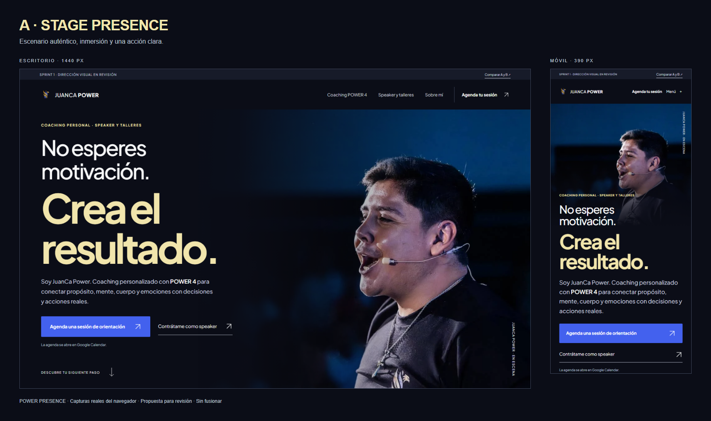
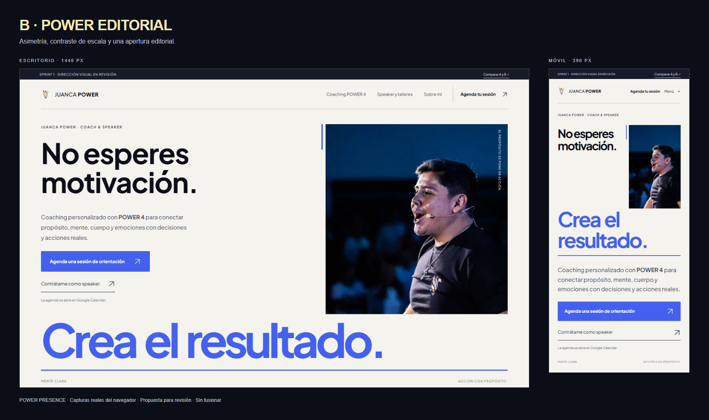

# Sprint 1 · POWER PRESENCE · Revisión de dirección

02/11/2026 · America/Lima. **Listo para comparar; diseño aún no aprobado.**

## Abre los previews reales
[Galería local](http://127.0.0.1:4322/juancapower-web-v2/conceptos/) · [A](http://127.0.0.1:4322/juancapower-web-v2/conceptos/stage-presence/) · [B](http://127.0.0.1:4322/juancapower-web-v2/conceptos/power-editorial/)

La galería corre en el equipo local; no es una URL pública. No se desplegó el rediseño ni se cambió Pages. Se puede reproducir con las instrucciones del README. Las capturas conservan la revisión aunque el servidor local se cierre.

## Compara las dos direcciones

### A · STAGE PRESENCE
Fotografía documental protagonista y lectura sobre un plano oscuro. El dorado concentra el resultado; el azul ofrece una acción comercial inmediata. Recomendada como punto de partida para la presencia cinematográfica solicitada: el rostro y el momento de escenario son la firma. Riesgo a revisar: la intensidad del primer plano y la expresión elegida deben representar cómo JuanCa quiere ser reconocido.

### B · POWER EDITORIAL
Asimetría, apertura clara de contraste, retrato en marco vertical y cambio de escala. Una presentación más editorial y sobria; los capítulos siguientes recuperan la base oscura. Riesgo a revisar: el rostro tiene menos peso en móvil y la apertura clara puede alejarse de la preferencia inicial dark. Se propone como dirección alternativa completa, no como variante de color de A.

No se mezclaron recursos de las referencias. Las dos direcciones conservan el mensaje y CTA para comparar composición y presencia. No hay generación de personas ni expansión de escenas.

## Entregables
- [Benchmark de tres referencias](VISUAL-BENCHMARK.md) y capturas actuales, con límites de acceso identificados.
- [Curaduría fotográfica para Home, Coaching, Speaker y Sobre mí](PHOTO-CURATION.md): 22 candidatas inspeccionadas, seleccionadas/reserva/excluidas identificadas.
- [Dirección, ritmo y decisiones comerciales](SPRINT-1-DIRECTION.md).
- [Sistema maestro](../design-system/MASTER.md) y [excepción propuesta](../design-system/pages/conceptos.md).
- Wireframes: [Home desktop](preview-captures/wireframe-home-1440.png), [Home móvil](preview-captures/wireframe-home-390.png), [Coaching desktop](preview-captures/wireframe-coaching-1440.png), [Coaching móvil](preview-captures/wireframe-coaching-390.png), [Speaker desktop](preview-captures/wireframe-speaker-1440.png), [Speaker móvil](preview-captures/wireframe-speaker-390.png).
- [POWER 4 en móvil](preview-captures/method-390.png): dos bases, dos columnas y techo, sin cuatro tarjetas genéricas.

## Validación técnica y visual
| Comprobación | Evidencia / estado |
| --- | --- |
| Build Astro | PASS, 10 rutas estáticas (4 existentes + 6 de exploración) |
| Navegador local | PASS, 44 pruebas: 27 nuevas + 17 de regresión |
| Ajuste tipográfico final B | PASS, 5 anchos revalidados; galería también verificada |
| Anchos de propuestas y wireframes | 360, 390, 768, 1024 y 1440px |
| Alturas de captura | 844px en móvil; 900px en tablet/escritorio |
| Acciones del hero | Primaria y secundaria visibles dentro del viewport probado |
| Accesibilidad automática | Sin infracciones axe detectadas en las rutas probadas |
| Interacción | Teclado, skip link, menú, navegación y test opcional comprobados |
| Movimiento | Reduced motion inicial y cambio en vivo comprobados; CSS, sin GSAP ni dependencias nuevas |
| Fotografía | Recortes de los 10 heroes revisados; rostro sin texto encima y sin pérdida de la cabeza |
| Wireframes | Tres rutas inspeccionadas visualmente en móvil y escritorio |
| Carga | Sin recursos fallidos, errores de página ni solicitudes a terceros en las rutas probadas |
| Recursos | Fuente local; retrato principal hasta 98,888 bytes WebP; srcset 480/768/1066 |
| GitHub | Rama de revisión; PR en borrador, no fusionar |
| Pages / producción / DNS | Sin publicación del rediseño ni acciones de modificación |
| Aprobación estética | PENDIENTE de selección explícita del usuario |

Los resultados técnicos no aprueban la dirección de arte ni sustituyen pruebas con personas. No se midieron conversiones, Core Web Vitals de campo o rendimiento en teléfonos físicos. Safari/iOS/Android reales y reserva/recepción de contactos siguen pendientes para una fase posterior.

## Estado de publicación
Punto de partida y main que deben permanecer intactos: `1d2c3a5ba1d4c9e0252fe66c7d47efc949033c62`. Staging de Sprint 0: https://juancapower.github.io/juancapower-web-v2/. Producción de referencia: repo `soy.juancapower`, SHA `927f34416ac4d552c30d250f7784a7675f446749` y dominio `www.juancapower.com`. Reconsultar al cerrar.

Las nuevas rutas existen solo en la rama y su build local / artifact de PR. No presentar esas rutas como URLs públicas publicadas.

## Decisión requerida
Elegir **A** o **B** como dirección principal y comentar intensidad fotográfica, recorte móvil y superficie clara/oscura. Después desarrollar la dirección elegida; no fusionar este rediseño como sustitución de la Home antes de esa elección.
